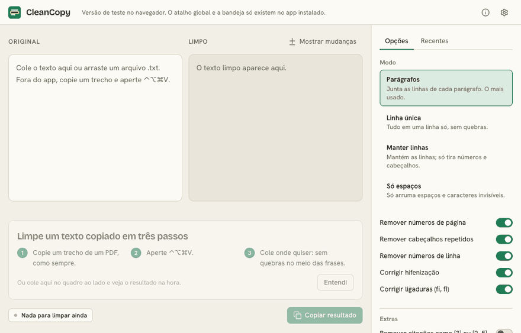
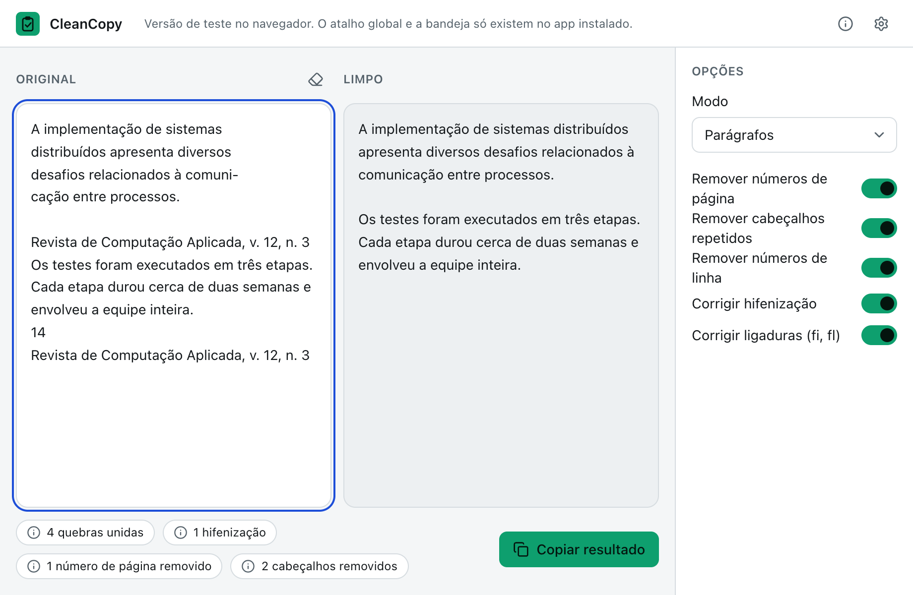
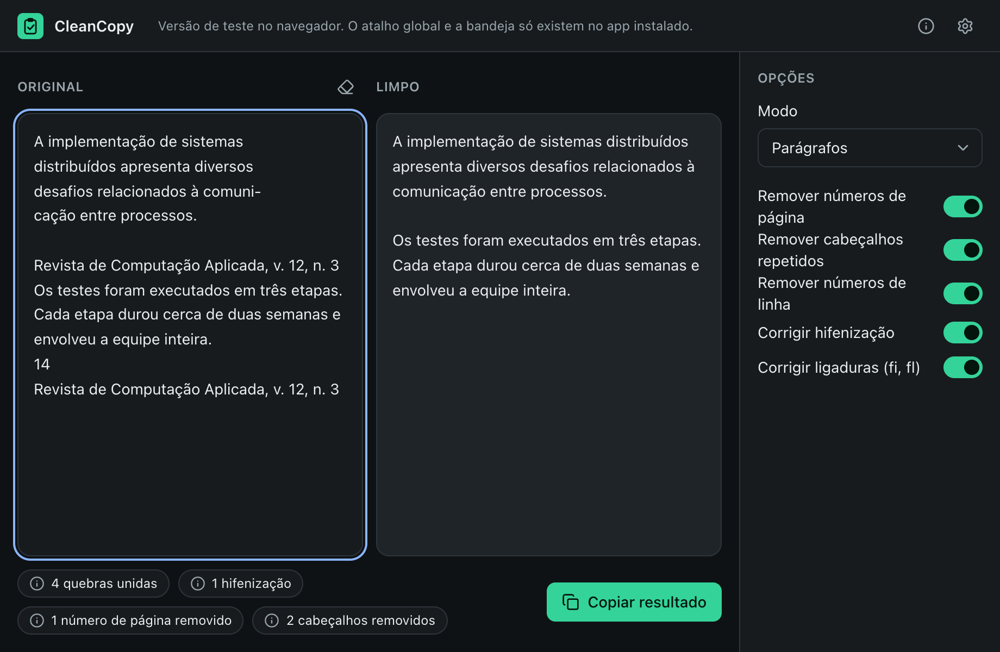

# CleanCopy

[Português](README.md)

Copy a passage from a PDF, press a shortcut, and paste it without the line breaks in the middle of sentences.

<!-- Record docs/demo.gif and uncomment the line below. -->
<!--  -->

| Light | Dark |
|---|---|
|  |  |

## Why it exists

Text copied from a PDF comes with a line break at the end of every line on the page, split words ("implemen- tation"), page numbers and headers in the middle of a paragraph. I used to fix that by hand every time I pasted a quote into a paper. CleanCopy does it for me.

## Download

Get the installer from the [Releases](../../releases) page:

- **macOS:** `CleanCopy_x.y.z_universal.dmg` (Apple Silicon and Intel)
- **Windows:** `CleanCopy_x.y.z_x64-setup.exe`

Try it in the browser without installing anything: <https://yanmfs.github.io/cleancopy/>. The web version only has the preview window; the global shortcut and the tray live in the installed app.

## First launch

The app is not signed with a paid certificate because it is a free personal project, so the system shows a warning the first time.

**macOS:** open the `.dmg`, drag CleanCopy to Applications and open it. If the system blocks it, go to System Settings → Privacy & Security and click "Open Anyway". If you see "is damaged", run this in Terminal:

```sh
xattr -cr /Applications/CleanCopy.app
```

**Windows:** the installer does not ask for administrator rights. If SmartScreen shows up, click "More info" and then "Run anyway".

## How to use

1. Open CleanCopy. It lives in the system tray (Windows) or the menu bar (macOS).
2. Copy a passage from a PDF as usual.
3. Press the shortcut: `Ctrl+Alt+Shift+V` on Windows, `⌃⌥⌘V` on macOS.
4. A notification shows what changed ("Text cleaned · 14 line breaks joined · 2 hyphenations fixed").
5. Paste anywhere. To undo, press the shortcut again within 5 seconds or use "Restore original" in the tray menu.

The main window shows the result live, lets you adjust the options and clean pasted text or dropped `.txt` files.

## What it does and does not do

It joins lines that belong to the same paragraph, resolves end-of-line hyphenation (keeping the hyphen in words like "encontra-se" and "segunda-feira"), removes page numbers, repeated headers and footers and line numbers, replaces ligatures (fi, fl) with letters and tidies spaces. Text that looks like code is left alone.

It does not:

- Rebuild two-column PDFs: the columns arrive mixed on the clipboard and there is no way to separate them afterwards.
- Understand the text. It follows rules and heuristics, so in ambiguous cases it can join what should stay apart, or the other way around. That is why the restore button exists.
- Touch tables, formulas or images.
- Read anything but plain text from the clipboard.

## Privacy

Everything happens on your machine. The app has no telemetry, does not check for updates, and the webview security policy blocks external connections. The original text stays in memory only, until the next cleaning or until you quit the app, and logs never record content.

## Run locally

Requirements: Node.js LTS, pnpm, Rust (stable) and, on macOS, the Xcode Command Line Tools.

```sh
pnpm install
pnpm tauri dev
pnpm test
```

## Roadmap

- One-step "clean and paste" that simulates the paste (macOS needs the Accessibility permission).
- More rules for PDFs with footnotes.

## Contributing

See [CONTRIBUTING.md](CONTRIBUTING.md). The best contribution is a PDF text that came out wrong, with the expected result.

## License

[MIT](LICENSE)
