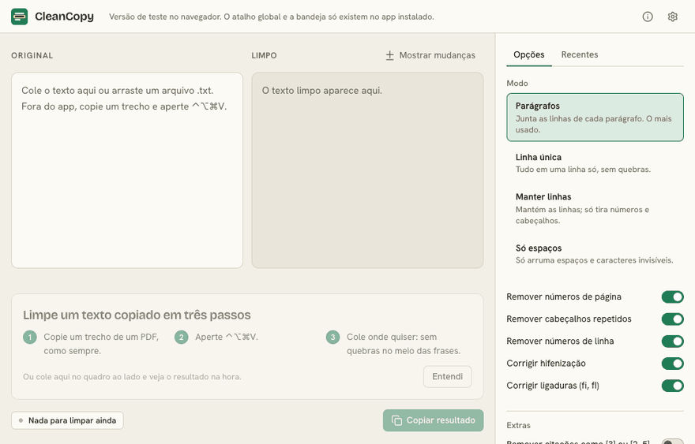
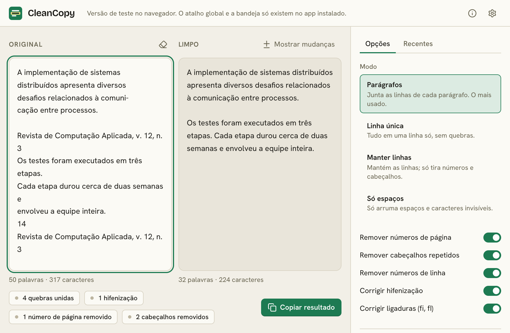
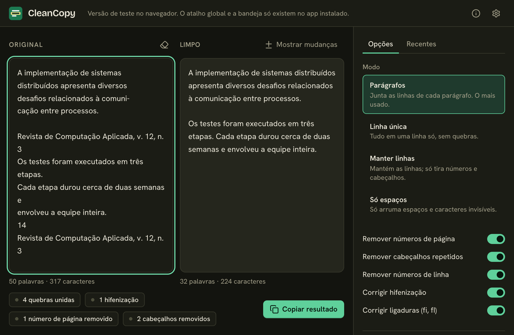

# CleanCopy

[English](README.en.md)

Copie um trecho de um PDF, aperte um atalho e cole o texto sem as quebras de linha no meio das frases.



| Claro                                                                 | Escuro                                                                |
| --------------------------------------------------------------------- | --------------------------------------------------------------------- |
|  |  |

## Por que existe

Texto copiado de PDF vem com quebra de linha no fim de cada linha da página, palavras partidas ("implemen- tação"), número de página e cabeçalho no meio do parágrafo. Eu consertava isso à mão toda vez que colava uma citação num trabalho. O CleanCopy faz isso por mim.

## Download

Baixe o instalador na página de [Releases](../../releases):

- **macOS:** `CleanCopy_x.y.z_universal.dmg` (Apple Silicon e Intel)
- **Windows:** `CleanCopy_x.y.z_x64-setup.exe`

Teste no navegador, sem instalar nada: <https://yanmfs.github.io/cleancopy/>. A versão web só tem a janela de prévia; o atalho global e a bandeja existem no app instalado.

## Primeira abertura

O app não é assinado com certificado pago, porque é um projeto pessoal e gratuito. Por isso o sistema mostra um aviso na primeira vez.

**macOS:** abra o `.dmg`, arraste o CleanCopy para Aplicativos e abra. Se o sistema bloquear, vá em Ajustes do Sistema → Privacidade e Segurança e clique em "Abrir Mesmo Assim". Se aparecer a mensagem "está danificado", rode no Terminal:

```sh
xattr -cr /Applications/CleanCopy.app
```

**Windows:** o instalador não pede administrador. Se o SmartScreen aparecer, clique em "Mais informações" e depois em "Executar assim mesmo".

## Como usar

1. Abra o CleanCopy. Ele fica na bandeja do sistema (Windows) ou na barra de menus (macOS).
2. Copie um trecho de um PDF como de costume.
3. Aperte o atalho: `Ctrl+Alt+Shift+V` no Windows, `⌃⌥⌘V` no macOS.
4. Uma notificação mostra o que mudou ("Texto limpo · 14 quebras unidas · 2 hifenizações"). Nas configurações dá para trocar a notificação por uma janelinha no canto da tela.
5. Cole onde quiser. Para desfazer, aperte o atalho de novo em até 5 segundos ou use "Restaurar original" no menu da bandeja.

A janela principal serve para ver o resultado ao vivo, ajustar as opções e limpar texto colado ou arquivos `.txt` arrastados. O botão "Mostrar mudanças" marca o que foi feito: o que saiu aparece riscado na coluna Original e o que foi juntado ou trocado aparece destacado na coluna Limpo.

## O que ele faz e o que não faz

Faz: junta linhas que pertencem ao mesmo parágrafo, resolve hifenização no fim da linha (mantendo o hífen de "encontra-se" e "segunda-feira"), tira número de página, cabeçalho e rodapé repetidos e numeração de linha, troca ligaduras (fi, fl) por letras e limpa espaços. Texto que parece código é deixado como está.

Não faz:

- Não reconstrói PDF em duas colunas: as colunas chegam misturadas na área de transferência e não há como separá-las depois.
- Usa regras e heurísticas, não entende o texto. Em casos ambíguos pode juntar o que devia ficar separado, ou o contrário. O botão de restaurar existe por isso.
- Não mexe em tabelas, fórmulas nem imagens.
- Lê só texto simples da área de transferência.

## Privacidade

Tudo acontece na sua máquina. O app não tem telemetria, não checa atualizações e a política de segurança do webview bloqueia conexões externas. O texto original fica só na memória, até a próxima limpeza ou até você fechar o app, e os logs não registram conteúdo.

## Rodar localmente

Pré-requisitos: Node.js LTS, pnpm, Rust (stable) e, no macOS, as Xcode Command Line Tools.

```sh
pnpm install
pnpm tauri dev
pnpm test
```

## Roadmap

- "Limpar e colar" em um passo, simulando a colagem (no macOS exige permissão de Acessibilidade).
- Mais regras para PDFs com notas de rodapé.

## Contribuir

Veja o [CONTRIBUTING.md](CONTRIBUTING.md). A melhor contribuição é um texto de PDF que saiu errado, com o resultado esperado.

## Licença

[MIT](LICENSE)
